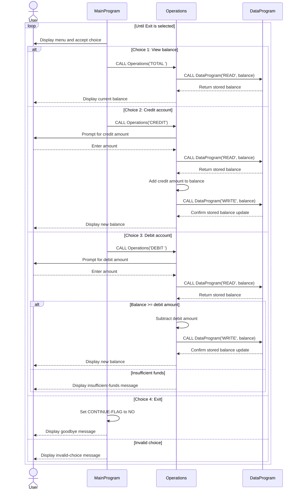

# COBOL Student Account Application

## Overview

This application provides a command-line account management interface for a student account. It allows the current balance to be viewed, an amount to be credited, or an amount to be debited. Account values are held in memory by `DataProgram`.

## COBOL Files

| File | Purpose | Key functions |
| --- | --- | --- |
| [`src/cobol/main.cob`](../src/cobol/main.cob) | Application entry point and interactive menu. | Displays menu choices 1-4, accepts the user's choice, dispatches view, credit, and debit operations to `Operations`, and repeats until Exit is selected. |
| [`src/cobol/operations.cob`](../src/cobol/operations.cob) | Implements account operations and coordinates balance reads and writes. | Handles `TOTAL`, `CREDIT`, and `DEBIT`; accepts operation amounts; calls `DataProgram` with `READ` or `WRITE`; and rejects debits that exceed the available balance. |
| [`src/cobol/data.cob`](../src/cobol/data.cob) | In-memory data store for the account balance. | Initializes the balance to `1000.00`, copies the stored balance when receiving `READ`, and updates the stored balance when receiving `WRITE`. |

## Key Functions

- **View balance (`TOTAL`)**: Reads the stored balance and displays `Current balance`.
- **Credit account (`CREDIT`)**: Reads the stored balance, adds the entered amount, writes the new balance, and displays the updated balance.
- **Debit account (`DEBIT`)**: Reads the stored balance and subtracts the entered amount only when the balance is sufficient.
- **Exit**: Sets the menu continuation flag to `NO` and terminates the application.

## Student Account Business Rules

- The account starts with a balance of **1000.00**.
- The balance has a six-digit integer portion and two decimal places.
- A credit may increase the balance; there is no additional credit approval or limit rule in the implementation.
- A debit is permitted only if the current balance is greater than or equal to the debit amount.
- If funds are insufficient, no balance change occurs and the message `Insufficient funds for this debit.` is displayed.
- The data store is volatile: `DataProgram` retains the balance while the COBOL programs remain running, but an application restart restores the initial balance of `1000.00`.
- Menu choices outside 1-4 are rejected with `Invalid choice, please select 1-4.`

## Sequence Diagram

